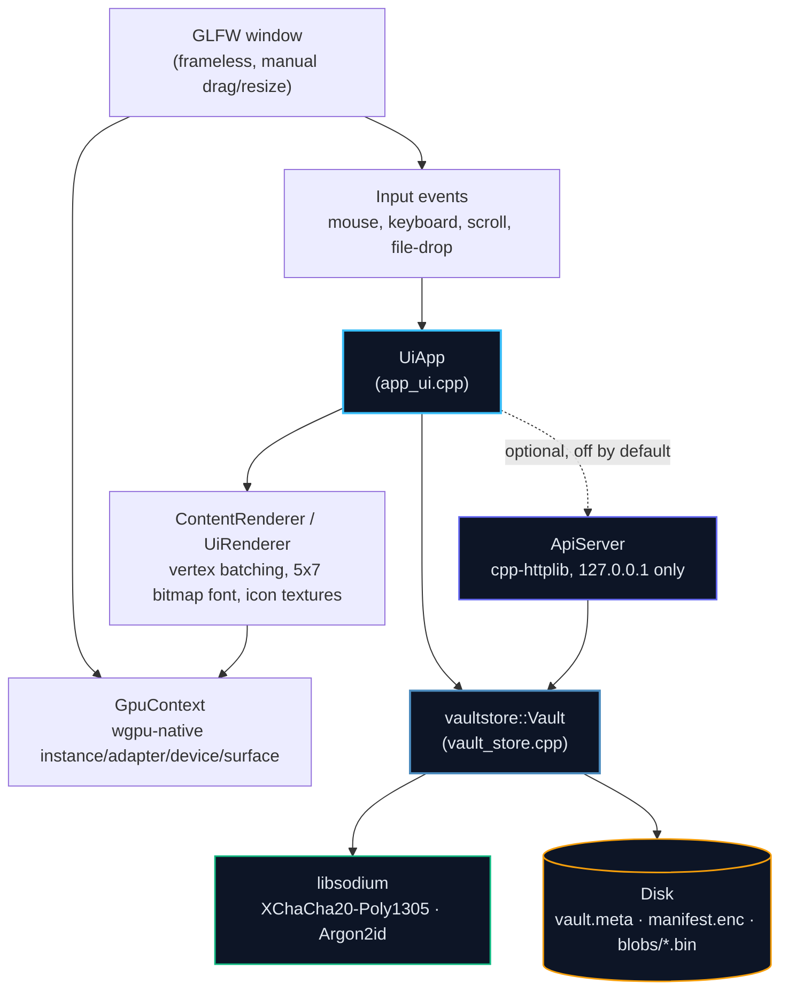

<div align="center">


<a href="#"></a>

<br/>


<br/>


</div>

<br/>

> [!IMPORTANT]
> **CryptVault is a from-scratch native application shell, not a wrapper around a browser or a game engine.** It talks to the GPU directly through wgpu-native, draws its own immediate-mode UI with a bitmap font, and encrypts everything it stores with a real AEAD cipher and a real KDF — not a toy XOR or an "obfuscated" zip. It has not been independently audited. Read [Security Model](#security-model) before trusting it with anything you can't afford to lose.

<br/>

## Table of Contents

- [What is CryptVault?](#what-is-cryptvault)
- [Two Sides: Files and Vaults](#two-sides-files-and-vaults)
- [Why This Project Exists](#why-this-project-exists)
- [Feature Overview](#feature-overview)
- [Architecture](#architecture)
- [How a Vault Works](#how-a-vault-works)
- [Encryption Design](#encryption-design)
- [Tech Stack & Rationale](#tech-stack--rationale)
- [Third-Party API](#third-party-api)
- [Repository Structure](#repository-structure)
- [Getting Started](#getting-started)
- [Build Targets](#build-targets)
- [Security Model](#security-model)
- [Known Limitations](#known-limitations)
- [Testing](#testing)
- [Roadmap](#roadmap)
- [Contributing](#contributing)

<br/>

## What is CryptVault?

CryptVault is a native Linux file explorer (with a Windows build of the vault half) that also stores files inside password-protected, encrypted vaults on your own disk. There is no cloud component, no account, and no background service — a vault is just a directory, and the app is a single executable that knows how to read and write it.

Under the hood it's an experiment in building a native app shell the hard way: no Electron, no Chromium, no game engine, no garbage collector. A GLFW window, a wgpu-native GPU surface, and a hand-written immediate-mode UI drawn with a 5x7 bitmap font — the whole rendering stack is a few thousand lines of C++ that talk to the GPU every frame.

```
Files  →  XChaCha20-Poly1305 (libsodium)  →  opaque blobs on disk
```

Open a vault with the right password and you see folders, tiles, and a tab bar. Anyone without the password sees a directory of randomly-named binary blobs and one small metadata file — no filenames, no folder structure, no file sizes leak without the key.

<br/>

## Two Sides: Files and Vaults

CryptVault is a native Linux file explorer with a locked half.

| | **Files** (unrestricted) | **Vaults** (restricted) |
|---|---|---|
| What it is | A normal file explorer over your real filesystem | Password-locked, encrypted vaults |
| Shows | Home, XDG folders, mounted drives, Trash | Only what you've unlocked |
| Operations | Open, rename, copy/cut/paste, new folder/file, move to Trash, restore, hidden files, sorting | Add/read/rename/delete files inside a vault |
| Switch | `FILES` / `VAULTS` pills in the status bar, or the command palette | |

The two sides are kept apart on purpose: the explorer never lists, reads or writes inside a vault - a vault folder just shows up with a lock icon, and opening it hands over to the vault side, which asks for the password. **Leaving the vault side locks every vault** (sessions and keys dropped, decrypted temp files deleted); turn that off from the command palette with `LOCK VAULTS ON LEAVE`.

**Selecting and acting:** click to select, Ctrl+click toggles, Shift+click selects a range, Ctrl+A selects all. Ctrl+C / Ctrl+X / Ctrl+V copy, cut and paste (Ctrl+Shift+C copies the paths as text); Delete moves to Trash; F2 renames; Enter opens; Backspace goes up; arrows move the selection; Ctrl+L (or click the address bar) types a path. Esc closes the topmost popup first and only quits when nothing is open. Dropping files from another app copies them into the open folder.

**Find:** Ctrl+F opens a find bar - typing filters the current folder live, Enter searches all subfolders (results show their relative path; right-click > SHOW IN FOLDER jumps there). Folders that are vaults are never searched inside.

**Encrypt into a vault:** right-click files or folders (or a multi-selection) > ENCRYPT INTO VAULT. The app switches to the vault side; open a vault and a folder, then choose ENCRYPT HERE. A separate ENCRYPT AND DELETE ORIGINALS button needs a second click and only deletes after every file encrypted successfully (it is a plain delete, not a secure wipe).

**Names in any language:** ASCII uses the built-in pixel font; everything else is drawn from TrueType fonts found on your system and **shaped with HarfBuzz**: Arabic letters join and run right to left, Hebrew reads right to left, Devanagari/Bengali/Tamil/Thai and the other complex scripts get their conjuncts and vowel signs, and accents/Greek/Cyrillic/CJK just work. The fonts are discovered, not bundled: install the usual Noto fonts (Fedora: `google-noto-sans-fonts`, `google-noto-sans-arabic-fonts`, `google-noto-sans-devanagari-fonts`, `google-noto-sans-cjk-fonts`, ...; DejaVu also covers Arabic/Hebrew) or point `CRYPTVAULT_FONT=/path/to/font.ttf` at one. **Colour emoji** (including family, skin-tone and flag sequences) are drawn from Noto Color Emoji if it is installed (Fedora `google-noto-color-emoji-fonts`, Debian/Ubuntu `fonts-noto-color-emoji`; only the CBDT bitmap build is read - the newer COLRv1 vector build is not, and without a usable colour font emoji fall back to monochrome symbols). Mixed-direction names use a compact implementation of the Unicode bidirectional algorithm, so an Arabic word followed by a year and `.pdf` is laid out the way a browser would. HarfBuzz is used if your system has it (`harfbuzz-devel`) and otherwise built from source; `-DCRYPTVAULT_ENABLE_HARFBUZZ=OFF` builds without it (then non-ASCII text is drawn one character at a time, with Hebrew/Arabic reordered but unjoined).

**Thumbnails:** PNG/JPEG/BMP/GIF/TGA files - and videos, if `ffmpeg` is installed - show a small preview. They are produced by a background worker (scrolling never stalls), for on-screen tiles only, and capped (least recently shown are freed). Toggle with the `THUMBNAILS` palette command.

**Video preview on hover (like Dolphin):** rest the pointer on a video file for a moment and a larger (320x180) muted, looping preview plays in a popup beside the cursor. It needs the `ffmpeg` command (optional - there is no codec library inside CryptVault; without it videos just keep the plain icon and you get a one-time hint). `ffmpeg` runs as a separate process started only while you hover, and is killed when you move away or quit. Install it with `sudo dnf install ffmpeg-free` (limited codecs) or the full `ffmpeg` from RPM Fusion; `CRYPTVAULT_FFMPEG=/path/to/ffmpeg` picks another binary. Toggle with `VIDEO PREVIEW ON HOVER` in the command palette. Only the explorer side ever does this - nothing inside a vault is decoded for display.

**Trash on every drive:** trashing a file on another mounted drive (USB disk, second SSD, ...) puts it in that drive's own trash (`.Trash-UID`, per the freedesktop spec) - a rename instead of a slow copy to your home drive - and the Trash view / `cryptvault trash list` show everything together.

<<<<<<< HEAD
**Moving files between CryptVault and other apps:** dragging files *into* CryptVault works. Dragging *out* is not possible - the windowing library (GLFW) cannot start a drag - so use the clipboard instead: Ctrl+C / Ctrl+X also publish the files to the system clipboard, and Ctrl+V pastes files copied in Dolphin, GNOME Files, Thunar and so on. This uses `wl-copy`/`wl-paste` (package `wl-clipboard`) on Wayland or `xclip` on X11; without them copy/paste still works inside CryptVault and you get a one-time hint. The clipboard format follows your desktop (`x-special/gnome-copied-files` for GNOME/XFCE/MATE/Cinnamon, `text/uri-list` for KDE/LXQt; override with `CRYPTVAULT_CLIPBOARD_FORMAT=gnome|uri-list`). COPY PATH (right-click, or Ctrl+Shift+C) puts the paths on the clipboard as plain text.
=======
**Drag files out to other apps:** press on a file (or a multi-selection) and pull it out of the window - drop it on Dolphin, GNOME Files, a terminal, a mail composer, ... The target receives the files as `text/uri-list` (plus plain-text paths) and does the copy or move itself. GLFW cannot start a drag, so CryptVault speaks the display server's protocol directly: `wl_data_device.start_drag` on Wayland (on a private event queue and thread of the same connection) and the XDND source protocol on X11 (on a private connection; libX11 is loaded at run time). Both are built when `libwayland-client` / the Xlib headers are present. Dropping back onto CryptVault's own window does nothing. Shift proposes "move" instead of "copy" on X11. Dragging files *into* CryptVault also works.

**Moving files between CryptVault and other apps via the clipboard:** Ctrl+C / Ctrl+X also publish the files to the system clipboard, and Ctrl+V pastes files copied in Dolphin, GNOME Files, Thunar and so on. This uses `wl-copy`/`wl-paste` (package `wl-clipboard`) on Wayland or `xclip` on X11; without them copy/paste still works inside CryptVault and you get a one-time hint. The clipboard format follows your desktop (`x-special/gnome-copied-files` for GNOME/XFCE/MATE/Cinnamon, `text/uri-list` for KDE/LXQt; override with `CRYPTVAULT_CLIPBOARD_FORMAT=gnome|uri-list`). COPY PATH (right-click, or Ctrl+Shift+C) puts the paths on the clipboard as plain text.
>>>>>>> 409ed34 (Drag n Drop)

### From the terminal (bash / zsh)

The same binary works without a window. Nothing stays unlocked between commands.

```bash
cryptvault                       # open the explorer      cryptvault ~/Downloads   # ...at a folder
cryptvault gui --vaults          # start on the vault side

cryptvault ls -la ~/Projects     # list (vault folders are marked)
cryptvault trash put old.zip     # freedesktop Trash - shows up in GNOME Files / Dolphin too
cryptvault trash list; cryptvault trash restore old.zip

cryptvault vault create secrets                 # prompts for a password (no echo)
cryptvault vault add secrets:/docs ~/taxes --delete-originals
cryptvault vault tree secrets
cryptvault vault get secrets:/docs/tax.pdf > /tmp/tax.pdf
echo "note" | cryptvault vault put secrets:/notes/today.txt
cryptvault vault --help          # and: cryptvault --help
```

Passwords come from a hidden prompt, or non-interactively from `--password-fd N`, `--password-file F`, or `$CRYPTVAULT_PASSWORD`. Exit codes: 0 ok, 1 error, 2 usage, 3 wrong password. Shell completion: `cryptvault completion bash|zsh` (installed automatically by `cmake --install`).

<br/>

## Why This Project Exists

Most "encrypted vault" apps on the desktop are either thin wrappers around OS-level disk encryption (BitLocker/LUKS — whole-volume, not per-file, not portable) or Electron apps that ship an entire Chromium runtime to render a password box. Neither answers a narrower question this project set out to explore: **what does it take to build a small, native, GPU-rendered application from first principles**, with a real encryption engine underneath, and no framework doing the hard parts for you?

That meant writing the window/input layer, the GPU surface setup, the immediate-mode UI renderer, and the vault storage engine all by hand, then wiring them together into something that's actually usable day to day — not just a rendering demo. The vault engine in particular (see [Encryption Design](#encryption-design)) is written and documented as if it were the security-critical component of a real product, because getting that part right is the actual point of the exercise.

<br/>

## Feature Overview

Everything below reflects what's implemented in the current source, not a wishlist.

### Vault management

| Feature | Notes |
|---|---|
| Create a new vault (name, location, password) | Guided multi-step wizard with a native OS folder picker |
| Open / lock a vault | Password re-entry required after locking; nothing stays decrypted in memory while locked |
| Change a vault's password | Re-wraps the master key only — does not touch or re-encrypt existing file content (see [Encryption Design](#encryption-design)) |
| Multiple vaults, multiple tabs | Each open vault gets its own tab; folders inside a vault are navigated tile-grid style |

### Working inside a vault

| Feature | Notes |
|---|---|
| Folders, nested arbitrarily deep | Tile-grid browsing with breadcrumb-style back/up navigation |
| Add files by drag-and-drop from the OS | Encrypted into the vault immediately on drop |
| Open a file | Decrypts to a temporary location and hands it to the OS's default application for that file type |
| Rename / delete | Delete on a folder recursively removes every blob underneath it, not just the manifest entry |
| Search | Filters the current folder's tiles as you type |
| Right-click context menu | Per-tile actions (rename, delete, open) |

### Application shell

| Feature | Notes |
|---|---|
| Frameless window with a custom border | No OS title bar; drag-to-move and a resize-toggle button are hand-implemented |
| Command palette | Keyboard-driven action launcher, fuzzy-matched against a fixed command list |
| Settings panel | Toggle for the third-party API (see below), a "clear all data" destructive action with a confirmation modal |
| Always-on-top toggle | Border right-click menu |
| Toast notifications | Transient confirmations for created/deleted/renamed actions |

### Third-party API (opt-in, off by default)

A local-only HTTP server that lets another process on the same machine read and write files inside vaults you already have unlocked in the app. See [Third-Party API](#third-party-api) for the full contract.

<br/>

## Architecture



`main.cpp` owns the window, the GPU device, and the process's one real clock; it drives the UI once per frame through a small, C-ABI-shaped entry-point surface (`UiAppCreate` / `UiAppBeginFrame` / `UiAppEndFrame`) rather than calling into UI internals directly, which keeps the render loop and the UI implementation as two independently reasoned-about pieces even though they're compiled into one binary. The vault storage engine (`vault_store.cpp`) has no dependency on GLFW, wgpu, or the UI at all — it can be built and exercised completely headless (see [Testing](#testing)).

<br/>

## How a Vault Works

A vault is a directory. Nothing is stored outside it, and nothing outside libsodium's own randomness is required to recreate one on another machine.

```text
<vault-dir>/
  vault.meta       small header: format version, Argon2id salt/cost
                   params, and the master key wrapped under a
                   password-derived key
  manifest.enc     the entire folder tree — real names, structure,
                   which blob backs each entry — encrypted as one
                   blob
  blobs/
    <random-id>.bin   one independently-encrypted blob per file,
                       named with no relationship to the real
                       filename
```

Opening a vault decrypts `manifest.enc` once (revealing the folder tree in memory) but leaves every file's content encrypted at rest until that specific file is opened. Locking a vault drops the decrypted tree and the derived keys from memory.

<br/>

## Encryption Design

**Two-layer key model:**

```
password --Argon2id(salt)--> KEK (key-encryption key)
KEK --AEAD-decrypt--> MK (master key, random, generated once at creation)
MK encrypts manifest.enc and every blob
```

The master key is never derived from the password — it's generated once, randomly, when a vault is created, and only ever exists wrapped (encrypted) under a key derived from the current password. This is what makes changing a password cheap: `ChangePassword` re-derives a new KEK with a fresh salt and re-wraps the same master key under it. `manifest.enc` and every file blob are untouched — no bulk re-encryption of vault content on a password change.

| Primitive | Choice | Why |
|---|---|---|
| AEAD cipher | XChaCha20-Poly1305 (`crypto_aead_xchacha20poly1305_ietf`) | Authenticated — detects tampering, not just decrypts. 24-byte nonces are large enough to generate randomly per encryption without a realistic collision risk, unlike AES-GCM's 96-bit nonces, which need a counter (or similar bookkeeping) to stay safe at scale. |
| KDF | Argon2id (`crypto_pwhash`), INTERACTIVE cost | Memory-hard password stretching. Deliberately not MODERATE/SENSITIVE cost today, since unlock currently runs synchronously on the UI thread — worth revisiting if unlock moves off-thread. |

**What this defends against:** someone with access to the vault directory itself — a stolen drive, a synced cloud backup, another account on a shared machine — reading file contents, filenames, or folder structure without the password.

**What this does not defend against:** malware already running as you while a vault is unlocked (it can read decrypted content or your password the same way you can), or someone watching you type the password. No software-only vault can close that gap — it isn't a shortcoming specific to this implementation.

A wrong password and a corrupted vault are made to look identical on failure, on purpose — an attacker shouldn't be able to learn anything about *why* an unlock attempt failed.

<br/>

## Tech Stack & Rationale

<table>
<tr><th>Layer</th><th>Chosen</th><th>Why</th></tr>

<tr>
<td><b>Windowing / input</b></td>
<td>GLFW 3.4 (fetched from source)</td>
<td>Small, well-understood, cross-platform surface for window creation and raw input, without pulling in a full application framework.</td>
</tr>

<tr>
<td><b>GPU / rendering</b></td>
<td>wgpu-native (WebGPU → D3D12 on Windows, Vulkan on Linux)</td>
<td>One graphics API surface instead of maintaining separate D3D12 and Vulkan backends by hand, while still talking to the GPU directly — no engine, no scene graph, no retained-mode widget toolkit.</td>
</tr>

<tr>
<td><b>UI rendering</b></td>
<td>Hand-written immediate-mode renderer + 5x7 bitmap font</td>
<td>The entire UI is redrawn from application state every frame, batched into vertex buffers and submitted in one render pass — no DOM, no retained widget tree to keep in sync.</td>
</tr>

<tr>
<td><b>Encryption</b></td>
<td>libsodium, vendored via a CMake wrapper</td>
<td>Audited implementations of XChaCha20-Poly1305 and Argon2id instead of hand-rolled cryptography — the single highest-leverage dependency choice in the project.</td>
</tr>

<tr>
<td><b>Local API transport</b></td>
<td>cpp-httplib (single header)</td>
<td>Minimal dependency footprint for a server that only ever needs to bind <code>127.0.0.1</code> and serve a handful of routes.</td>
</tr>

<tr>
<td><b>Build system</b></td>
<td>CMake 3.20+, with GLFW/libsodium/cpp-httplib fetched at configure time</td>
<td>Nothing to preinstall beyond a compiler and CMake itself — every dependency source is pulled and built as part of the same configure step.</td>
</tr>

</table>

<br/>

## Third-Party API

Off by default — toggled on from the Settings panel. When enabled, CryptVault runs a local-only HTTP server so another process on the same machine can read and write files inside vaults you already have unlocked, without ever handling your password itself.

**Design constraints, by construction:**

- Binds `127.0.0.1` only, on an OS-assigned port — never a fixed port, never any other interface.
- Authenticated with a random bearer token, regenerated every time the server (re)starts.
- Has no password-checking path of its own and no way to unlock a vault — it can only ever see what's *already* unlocked in the running app.
- Publishes its port and token to a small local discovery file (owner-read/write only) while running, and removes it when the server stops — the same idea as how tools like Jupyter publish their own connection info.

| Method | Route | Auth | Purpose |
|---|---|:---:|---|
| `GET` | `/v1/ping` | none | Liveness check |
| `GET` | `/v1/vaults` | bearer | Currently-unlocked vaults: `[{index, name}]` |
| `GET` | `/v1/vaults/{index}/tree` | bearer | That vault's decrypted folder tree |
| `GET` | `/v1/vaults/{index}/file?path=..` | bearer | A file's decrypted bytes |
| `POST` | `/v1/vaults/{index}/file?path=..` | bearer | Encrypts the request body as that file; the parent folder must already exist — this never auto-creates folders |

<br/>

## Repository Structure

```text
CryptVault/
├── CMakeLists.txt
├── assets/
│   ├── background.png
│   └── icons/
├── src/
│   ├── main.cpp              # process shell: window, GPU device, frame loop
│   ├── debug_repro.cpp       # scripted-input harness for reproducing UI bugs
│   ├── window/                # GLFW wrapper
│   ├── gpu/                   # wgpu-native surface setup
│   ├── ui/
│   │   ├── app_ui.cpp/.h      # application state, screens, ApiServer
│   │   ├── ui_renderer.cpp/.h # immediate-mode drawing primitives
│   │   ├── animation.h
│   │   └── font5x7.h
│   ├── vault/
│   │   ├── vault_store.cpp/.h # encrypted vault engine
│   │   └── vault_store_test.cpp
│   └── platform/               # folder picker + "open with OS default app"
│                                 (Windows / Linux implementations)
└── LICENSE
```

<br/>

## Getting Started

### Quick start (Fedora)

```bash
scripts/install-deps.sh                 # dnf/apt/pacman/zypper - or see the list in CMakeLists.txt
cmake -B build -G Ninja -DCMAKE_BUILD_TYPE=Release
cmake --build build
ctest --test-dir build --output-on-failure
sudo cmake --install build              # or: cmake --install build --prefix ~/.local
cryptvault                              # opens the explorer; `cryptvault --help` for the terminal commands
```

Needs CMake 3.20+ and a C++17 compiler. Anything not found on the system (libsodium, GLFW >= 3.4, cpp-httplib) is fetched and built automatically; wgpu-native and `stb_image.h` are downloaded as pinned, checksum-verified files at configure time (x86_64 and aarch64 Linux). To use your own copies: `-DWGPU_NATIVE_DIR=...`, `-DSTB_DIR=...`, or `-DCRYPTVAULT_USE_SYSTEM_LIBS=OFF`.

**Terminal-only build** (no GPU stack, no GLFW, nothing graphical - runs over SSH or in a container):

```bash
cmake -B build -DCRYPTVAULT_BUILD_GUI=OFF && cmake --build build   # -> build/cryptvault-cli
```

### Display servers

The window picks **native Wayland** when the session is Wayland and **X11** otherwise (GLFW >= 3.4 decides at runtime and falls back). Force one with `CRYPTVAULT_PLATFORM=x11` or `CRYPTVAULT_PLATFORM=wayland`. On Wayland the window uses compositor decorations instead of the custom frameless border, because Wayland clients can't move their own window or pin it on top. High-DPI scales (2x etc.) are handled.

<br/>

## Build Targets

| Target | Purpose |
|---|---|
| `cryptvault` | The application: opens the explorer window, or runs a terminal command when given one (`cryptvault ls`, `cryptvault vault ...`) |
| `cryptvault-cli` | Terminal-only build: libsodium + the C++ standard library, nothing graphical |
| `vault_store_test` | Headless test for the encryption engine alone |
| `fs_ops_test` | Headless test for the file-explorer engine (listing, copy/move, freedesktop Trash) |
| `debug_repro` | Opt-in (`-DCRYPTVAULT_BUILD_DEBUG_REPRO=ON`): drives the UI with scripted synthetic input to reproduce bugs |

<br/>

## Security Model

### Implemented

- Real AEAD encryption (XChaCha20-Poly1305) for every file blob and the folder manifest, not just the vault's password check
- Argon2id password stretching before any key derivation
- A two-layer key model so password changes never require re-encrypting vault content
- Filenames and folder structure encrypted along with file contents — a locked vault directory reveals nothing but a count of opaque blobs
- Wrong-password and corrupted-vault failures made indistinguishable on purpose
- The third-party API is off by default, loopback-only, token-authenticated, and structurally unable to unlock a vault itself

### Not implemented

- Independent third-party security audit
- Encrypted memory / secure-erase guarantees on decrypted content held in RAM while a vault is unlocked
- Any defense against malware already running as the same user while a vault is unlocked
- Multi-user or multi-device sync — a vault is a plain local directory; anything more is up to the OS or the user's own backup tooling

<br/>

## Known Limitations

- Argon2id currently runs at INTERACTIVE cost, synchronously on the UI thread - unlocking a vault briefly blocks the UI.
- Non-ASCII text needs system fonts that cover the script (see above); a script with no installed font draws as a gap. Colour emoji need the CBDT build of Noto Color Emoji (not COLRv1/SVG fonts such as Twemoji). The bidi layout covers the common cases (words, numbers, punctuation, brackets) but not explicit embedding/override/isolate characters or bracket pairing. ASCII stays in the pixel font and is shown in capitals.
- Video previews need the `ffmpeg` command; the first thumbnail of a long video can take a second or two. Image thumbnails use a 64 px texture, so they look soft on large tiles.
- Subfolder search is bounded (500 results / ~150k entries visited) and runs in the background, but a search of a huge tree still takes a while to finish.
<<<<<<< HEAD
- No drag-out of files to other apps (GLFW can't start a drag) - use the file clipboard or COPY PATH. Pasting files copied in other apps on Wayland relies on `wl-paste`, which hung intermittently on the headless test compositor (sway); copying out and the X11 clipboard were verified, and on a timeout CryptVault falls back to its own clipboard.
=======
- Drag-out: on Wayland the drag image is a generic page icon (not a rendering of your selection) and on X11 the pointer keeps its normal cursor during the drag, because the window toolkit owns the cursor. It was verified end to end with a scripted pointer (sway + a virtual pointer, and Xvfb + xdotool) dropping onto separate client windows, including multi-selections and a drop back onto CryptVault itself - not against the real Dolphin/GNOME Files. Pasting files copied in other apps on Wayland relies on `wl-paste`, which hung intermittently on the headless test compositor (sway); copying out and the X11 clipboard were verified, and on a timeout CryptVault falls back to its own clipboard.
>>>>>>> 409ed34 (Drag n Drop)
- Fractional display scaling on Wayland works (GLFW 3.4 implements `wp_fractional_scale`; checked at 1.25x, 1.5x, 2x and 2.5x), but only on compositors that offer that protocol - others fall back to integer scaling.
- Vault files are read fully into memory when added/opened, so very large files need that much RAM.
- Native Wayland was verified under sway (headless) only; GNOME/KDE sessions have not been tried. Headless Weston crashes inside GLFW 3.4 because it advertises no input seat - a GLFW issue, not CryptVault's.
- No macOS build target yet.

<br/>

## Testing

<<<<<<< HEAD
`ctest --test-dir build --output-on-failure` runs three headless suites (no GPU or display needed):
=======
`ctest --test-dir build --output-on-failure` runs several headless suites (no GPU or display needed):
>>>>>>> 409ed34 (Drag n Drop)

- `vault_store` - the encryption engine: create, unlock, folder/file operations, password change, tamper checks.
- `fs_ops` - the explorer engine: sorting, symlinks, vault detection, copy/move/rename, and the freedesktop Trash (round-tripping odd file names, restore without overwrite), all in a sandboxed `$HOME`.
- `cli_smoke` - the real `cryptvault-cli` binary end to end: file commands plus a full vault round trip (create, add folders, get, put, rename, delete, password sources, exit codes, "no plaintext on disk").

`debug_repro` (opt-in) drives the real UI code with scripted input frames so a UI bug can be reproduced identically every time.

<br/>

## Roadmap

- [x] Non-ASCII file names (system TrueType fallback via stb_truetype)
- [x] Explorer: multi-select, keyboard shortcuts, find/search, thumbnails
- [x] "Encrypt into vault" from the explorer's context menu
- [x] Per-volume trash, background thumbnails/search, hover video preview
- [x] Complex-script shaping with HarfBuzz (Arabic joining, Indic, Thai, ...) and fractional Wayland scaling
- [x] Send/receive files via the system clipboard (stand-in for drag-out)
- [x] Colour emoji (CBDT) and bidirectional layout
<<<<<<< HEAD
- [ ] Real drag-and-drop out of the window. Not built on purpose: GLFW cannot start a drag, and doing it ourselves means a second Wayland protocol client (data-device + input serials, impossible to verify without a real compositor session) plus an XDND source for X11 - a large, risky change for something the file clipboard already covers. Revisit if the windowing layer is ever replaced.
=======
- [x] Real drag-and-drop out of the window (Wayland data-device and X11 XDND)
>>>>>>> 409ed34 (Drag n Drop)
- [ ] Move Argon2id unlock off the UI thread, and raise the cost parameters once it is
- [ ] Flatpak / AppImage / RPM packaging (needs `--filesystem=host` style access to behave as a file manager)
- [ ] macOS support for the platform-specific folder picker / open-file code
- [ ] Expand the third-party API surface (folder creation, delete, rename) if a real use case for it emerges

<br/>

## Contributing

Issues, pull requests, and design discussions are welcome — especially around the encryption engine and the third-party API's threat model, since those are the parts most worth a second pair of eyes.

<br/>

<div align="center">


**Files stay local. Only what a valid password can decrypt is ever readable.**

</div>